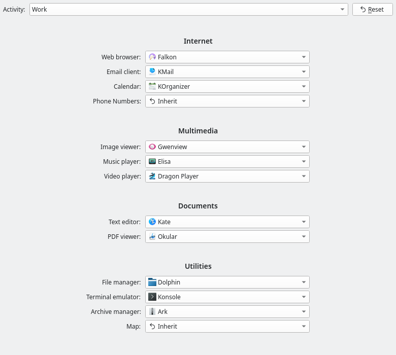
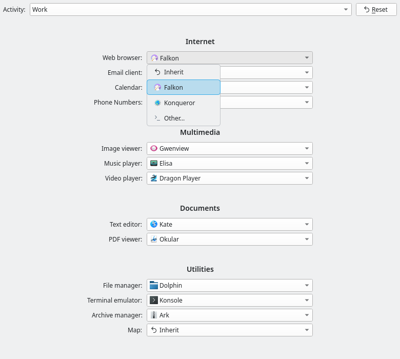

# Activity Defaults Switcher

A KDE Plasma 6 project that gives each KDE Activity its own default
applications — web browser, email client, text editor, and so on. It has two
parts:

- **Daemon** — an always-on kded6 module that rewrites the system-wide default
  for each component to match the current Activity. Switch to your work
  Activity and links open in the work browser; switch back and they open in
  your personal one.
- **System Settings module (KCM)** — a QML `KQuickConfigModule` to view, edit,
  and reset per-Activity profiles.

## Screenshots

The System Settings module, shown with the sample activities *Home* (baseline)
and *Work*:

| Per-activity profile | Component picker |
| -------------------- | ---------------- |
|  |  |

## How it works

The profile store (`activity-defaults-switcherrc`, one group per component) is
the single source of truth shared by both parts:

- The **daemon** resolves the current Activity's profile and rewrites the
  system-wide default (`mimeapps.list` for most components, `kdeglobals` for
  the terminal) whenever the Activity changes, a System Settings default is
  edited, or the profile store changes. Every application — native or Flatpak —
  resolves through those files, so one write point covers both.
- The **KCM** reads and writes the profile store directly and stays a dumb
  editor; the daemon watches the store and applies edits live
  (see [ADR-0002](docs/adr/0002-kcm-writes-profile-store-daemon-watches.md)).

See the repository glossary (`CONTEXT.md`) for the domain vocabulary and
`docs/adr/` for the design rationale.

## Requirements

- CMake 3.16+
- Extra CMake Modules (ECM)
- A C++20 compiler
- Qt 6 (`Core`, `Test`, QML)
- KF6 (`Service`, `Config`, `CoreAddons`)
- For the kded6 module: KF6 `DBusAddons` and Plasma Activities **dev** packages
- For the KCM: KF6 `KCMUtils`, `KDeclarative`, `KIO` and `I18n` **dev** packages,
  plus the Kirigami QML modules

`make deps` (via `scripts/setup-deps.sh`) installs the required KF6 / Plasma /
Qt6 dev packages system-wide with apt — the same set the CI workflow
installs.

## Getting started

```sh
sudo make deps    # installs the KDE dev packages system-wide (apt)
make build
make test
```

To install the daemon into the running KDE session:

```sh
sudo make install
```

`make install` builds, then runs `cmake --install` into Qt's real plugin
location (`${KDE_INSTALL_PLUGINDIR}/kf6/kded`). Remove it again with
`sudo make uninstall`. For packaging, override the prefix and use `DESTDIR` as
usual:

```sh
cmake -S . -B build -DCMAKE_INSTALL_PREFIX=/usr
DESTDIR=/tmp/stage make install
```

`make build` configures into `./build` (gitignored) on first use and then builds
incrementally.

## Development tasks

All common tasks are wired up as `make` targets:

| Target | What it does |
| ------ | ------------ |
| `make build`        | Configure (if needed) and build |
| `make test`         | Build, then run the CTest suite |
| `make install`      | Build and install to `${KDE_INSTALL_PLUGINDIR}` |
| `make uninstall`    | Remove what `make install` put in place |
| `make lint`         | Format check + clang-tidy (skips tools not installed) |
| `make format`       | Apply `clang-format` to `src/` and `tests/` in place |
| `make format-check` | Fail if `clang-format` would change anything |
| `make tidy`         | Run `clang-tidy` static analysis |
| `make configure`    | (Re)run the cmake configure step |
| `make clean`        | Remove the `build/` directory |
| `make deps`         | Install KDE dev packages system-wide (apt) |
| `make check`        | `lint` + `test` (the full gate) |
| `make help`         | Print the target list (default target) |

`make format`, `make format-check`, and `make tidy` fail with a clear message if
the corresponding tool (`clang-format` / `clang-tidy`) is not in `PATH`. The
combined `make lint` gate instead skips missing tools and only fails when an
installed tool reports a problem.

The build, test, and tool settings are overridable:

```sh
make build BUILD_DIR=build-ninja CMAKE_FLAGS="-G Ninja"
```

## Project layout

```
src/       shared domain (resolver, profile, store, writer), the kded6
           module, and the KCM
tests/     Qt Test suites (resolver, writer, switcher, store, module, kcm,
           and an offscreen KCM QML smoke test under tests/kcm_qml/)
docs/adr/  architecture decision records
scripts/   setup-deps.sh (installs the KDE dev packages via apt)
build/     out-of-source CMake build directory (gitignored)
```

Install destinations follow KDE convention via `KDEInstallDirs`: the daemon
lands in `${KDE_INSTALL_PLUGINDIR}/kf6/kded`; the KCM lands under
`${KDE_INSTALL_KCMDIR}`.

## CI

GitHub Actions (`.github/workflows/ci.yml`) runs on every push and pull
request in a Debian `forky` container. It bootstraps `make` + git, then runs
the same `make` tasks an engineer runs locally — `make deps` to install the
build/toolchain packages, then `make build`, `make test`, `make lint`, and
`make format-check` — failing the job on any failure (including formatting
drift). The dependency list lives in one place (scripts/setup-deps.sh), shared
by CI, `make deps`, and `make ci`.

Run the same thing locally before pushing with `make ci` (needs `podman`):
it copies the repo into a clean `debian:forky` container and runs the same
make tasks, so the local `build/` directory never skews the result.

## License

Licensed under the GNU Lesser General Public License, version 3 or later
([LGPL-3.0-or-later](https://spdx.org/licenses/LGPL-3.0-or-later.html)).
See [LICENSE](LICENSE) for the full license text.
